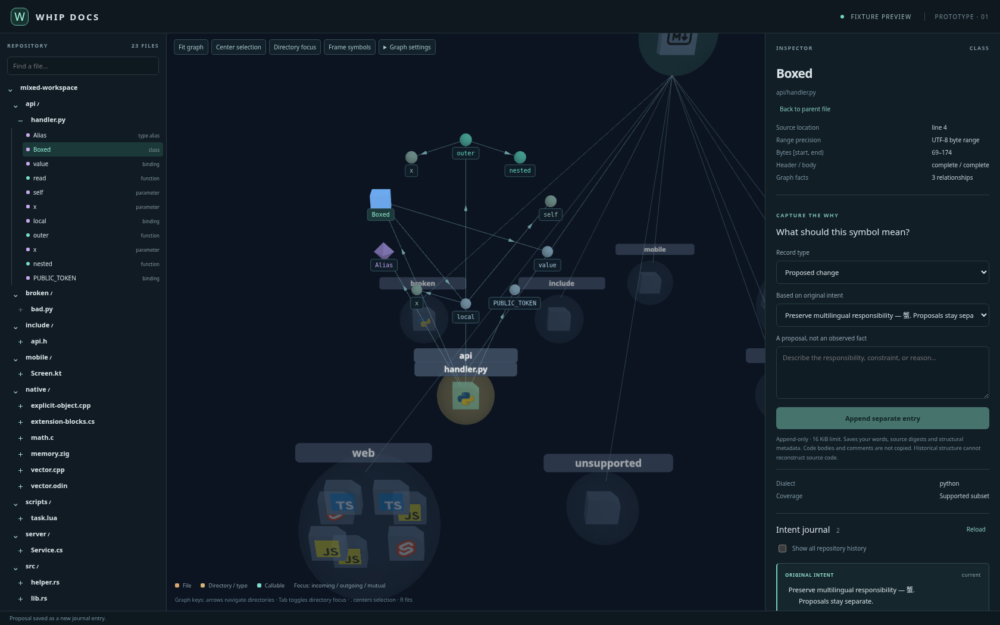

# Whip Docs

Explore a codebase as a graph, and keep the reasoning attached to its symbols.

Whip Docs is a local code-architecture explorer built with Rust, Tauri and Svelte. Expand files into declarations, follow the relationships the analyzer can establish, and preserve original intent alongside separate interpretations and proposed changes.



*Browser fixture preview using recorded Rust-service output. [Details](verification/integration/README.md).*

## Try the browser preview

Use Node.js 22 or later and npm 10 or later:

```bash
git clone https://github.com/MrScripty/whip-docs.git
cd whip-docs
npm ci
npm run dev
```

Open `http://127.0.0.1:1420/?preview=mixed`. Expand a file, select a declaration and preserve an original intent entry. Later interpretations and proposals remain separate entries. Preview records stay in that browser's local storage.

The preview displays recorded analysis; it does not analyze directories through native IPC. A plain browser without the preview flag shows a desktop-required message.

## Explore your own repository

In a configured Rust/Tauri environment with your platform's native prerequisites:

```bash
npm run dev:desktop
```

Open a local source directory by its absolute path. It does not need a `Cargo.toml`. The native design stores an append-only intent journal locally and binds entries to analyzed source digests; proposals do not change repository code.

This is a prototype. Native linking, IPC and restart acceptance remain unqualified. Language support covers tested syntax subsets, with explicit gaps; see the [grammar qualification matrix](docs/design/grammar-qualification.md).

## Develop

```bash
npm run check
npm run build
cargo test --no-default-features --workspace --all-targets --locked
```

[PROTOTYPE.md](PROTOTYPE.md) covers native setup, graph controls, journal privacy, stale bindings and verification. The [integration record](verification/integration/README.md) separates browser, backend and native evidence.

The former Studio Whip documentation website is retained in Git history.

[MIT License](LICENSE).
