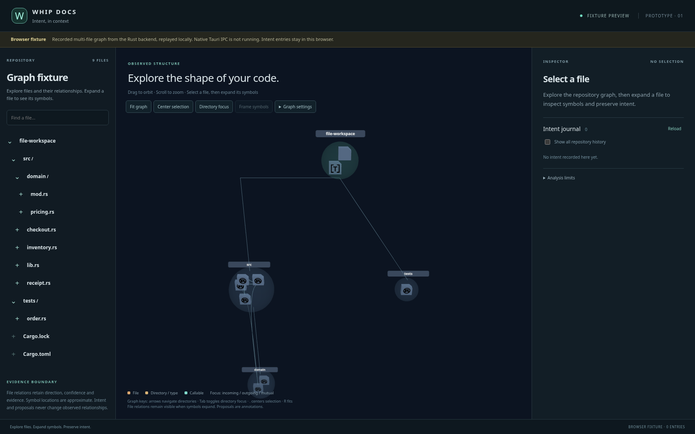
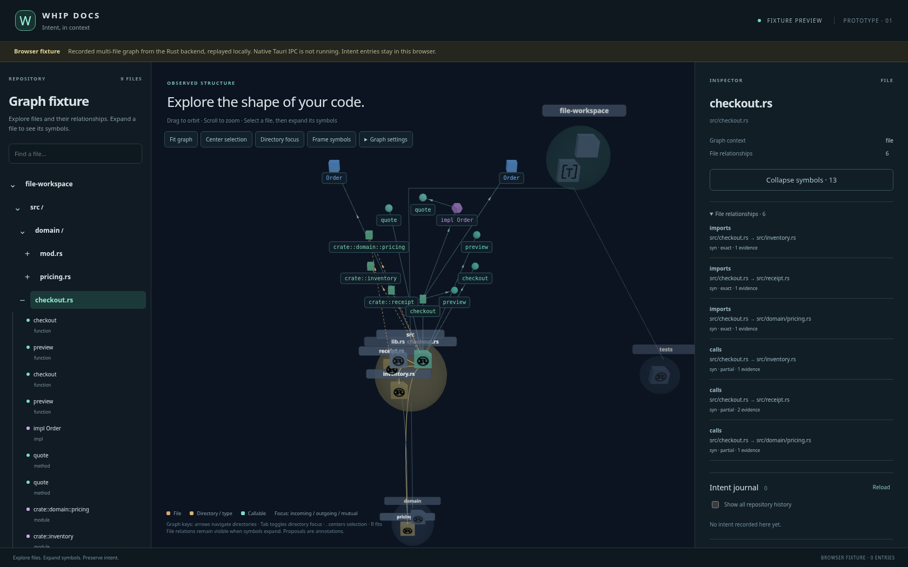

# Browser fixture screenshots

Actual Chromium captures of the interface at
`83aaff1dd6f4acae11a292d2bb8221adeca1e75e`, replaying recorded Rust backend data
from the public synthetic fixture. Native Tauri IPC is not running or validated
by these screenshots. No private source is shown.

File overview: the original repository, directory and file geometry inside the
new intent workspace theme.

Expanded file: optional typed symbols share the existing scene and camera,
anchored to their parent file while the original file graph remains present.
