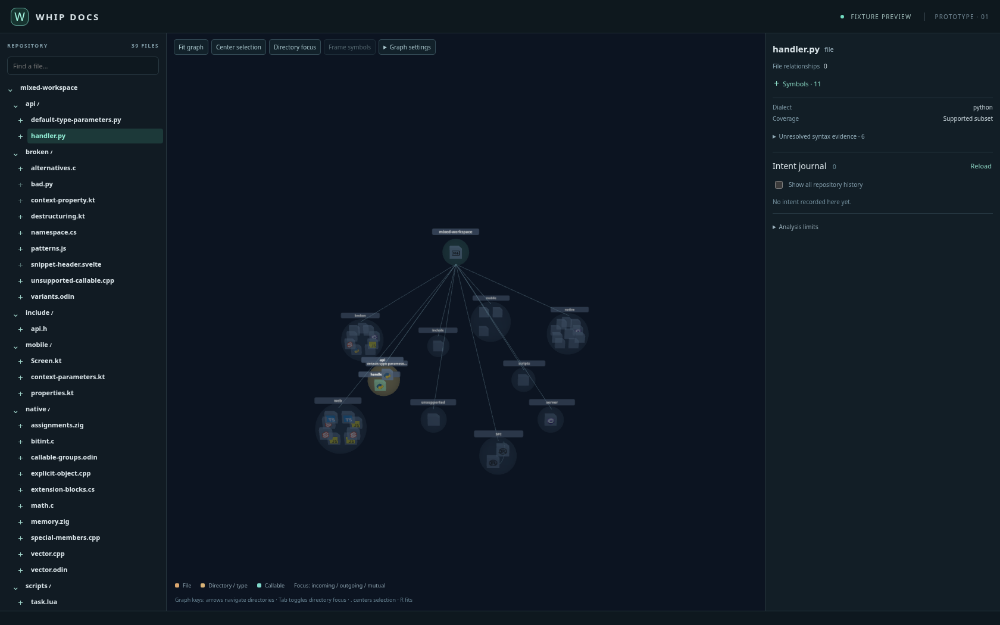
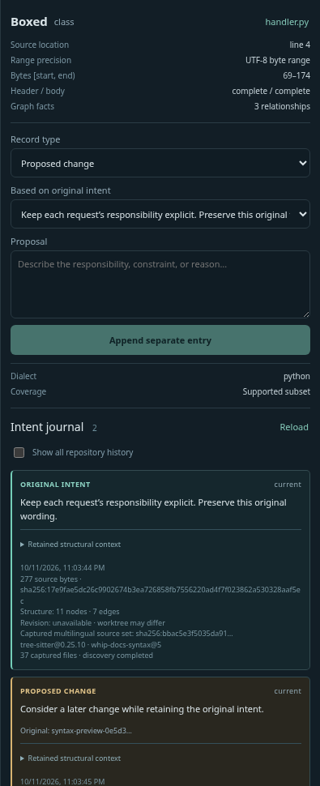

# Current compact inspector screenshots

Fresh, unedited Chromium captures of the compact inspector follow-up to
`0efd5e8e7aab8c525f98839a9466685bcb98c731`, using extractor
`whip-docs-syntax@5` and the 39-file public synthetic fixture (37 sources captured).
[Capture provenance](compact-inspector-provenance.json) records the timestamp,
viewports and exact SHA-256 hashes of the UI component, stylesheet and fixture.
Native Tauri IPC is not running or validated. No private source or model inference
is involved. These replace the previous @3 captures of the earlier inspector.

The original file/directory geometry and routing remain authoritative.

Expanded Python symbols share the original scene and camera. The selected symbol,
kind and parent-file link share one compact row. Full paths remain available to
assistive technology and through tooltips; exact ranges and coverage remain visible.
Original intent and proposals remain separate. The disabled append button follows
successful submission and the cleared input.

This is a direct screenshot of the rendered inspector element, without image editing.
Requested heading/help prose is removed; provenance, binding status and original
text remain visible. The panel scrolls to further journal entries and metadata.

[768px layout](compact-expanded-768.png) · [390px layout](compact-expanded-390.png) ·
[360px layout](compact-expanded-360.png). Narrow layouts retain the existing stacked
scene/inspector arrangement and independently scrollable inspector. Browser checks
verify control reachability, keyboard order and no horizontal overflow at every width.

See [compact inspector verification](../../verification/integration/inspector-compact.md).
Reproduce with `verification/integration/capture-inspector.cjs` and installed
Playwright/Chromium, setting `PLAYWRIGHT_MODULE`, `CHROMIUM_PATH`, `GRAPH_TEST_ORIGIN`
and `EVIDENCE_DIR` for local paths. No sandbox permission override was needed for
these captures.

# Historical Rust fixture screenshots

Actual Chromium captures of the interface at
`83aaff1dd6f4acae11a292d2bb8221adeca1e75e`, replaying recorded Rust backend data
from the public synthetic fixture. Native Tauri IPC is not running or validated
by these screenshots. No private source is shown.

File overview: the original repository, directory and file geometry inside the
new intent workspace theme.

Expanded file: optional typed symbols share the existing scene and camera,
anchored to their parent file while the original file graph remains present.
